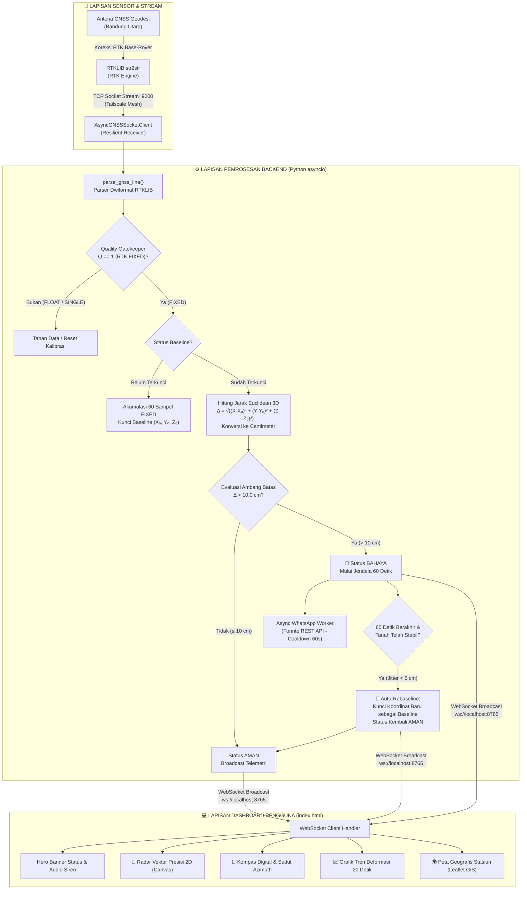

# 🛰️ GeoAlert: Real-Time GNSS Ground Displacement & Earthquake Early Warning System

<div align="center">


**Sistem Peringatan Dini Gempa Bumi & Deformasi Permukaan Tanah Berbasis Aliran Data Real-Time GNSS RTK Presisi Tinggi**

[Fitur Utama](#-fitur-utama) •
[Arsitektur Sistem](#-arsitektur-sistem) •
[Instalasi](#-instalasi--persiapan) •
[Panduan Menjalankan](#-panduan-menjalankan) •
[Protokol WebSocket](#-spesifikasi-protokol-websocket) •
[Metodologi Geodesi](#-metodologi-geodesi--seismologi)

</div>

---

## 📖 Ringkasan Proyek (Executive Summary)

**GeoAlert** adalah platform *Earthquake Early Warning System* (EEWS) dan pemantau deformasi tektonik berbasis **GNSS (Global Navigation Satellite System)** presisi tinggi dengan teknologi **RTK (Real-Time Kinematic)**. Sistem ini mengamati pergeseran spasial 3D tanah secara *real-time* langsung dari stasiun geodetik (`GALT-BDG-01`, Bandung Utara) melalui aliran data TCP dari **RTKLIB str2str**.

Ketika terdeteksi pergeseran tanah seketika melampaui ambang batas bahaya **10.0 Centimeter (0.10 Meter)**, sistem memicu alarm darurat visual dan audio otomatis pada dashboard web, memproyeksikan arah pergeseran tanah pada peta vektor spasial & kompas digital 360°, serta mengirimkan notifikasi darurat langsung ke pemangku kepentingan (*stakeholders* / BPBD) via WhatsApp Gateway secara asinkron.

---

## 🌟 Fitur Utama

- **📡 Resilient Async TCP Socket Client:** Mendengarkan aliran data geodetik dari node Tailscale RTKLIB secara asinkron dengan mekanisme *reconnect* otomatis jika terjadi pemadaman jaringan (*network fault-tolerance*).
- **🔒 Strict Baseline Calibration (60 Sampel FIXED):** Mengunci koordinat referensi awal (*baseline*) hanya jika telah terkumpul **60 sampel berturut-turut berstatus RTK FIXED ($Q=1$)**. Jika terpotong oleh status `FLOAT`, buffer kalibrasi otomatis dibersihkan dan diulang dari awal demi menjaga integritas milimeter.
- **🛡️ Post-Calibration Quality Gatekeeper (Anti-False Alarm):** Menahan data berstatus `FLOAT` setelah baseline terbentuk. Hanya data berstatus **FIXED** yang dihitung pergeserannya untuk mencegah alarm palsu akibat noise satelit.
- **⚡ Ambang Batas 10.0 cm & Deformasi 3D:** Menghitung jarak spasial Euclidean 3D real-time terhadap baseline terkunci dengan klasifikasi otomatis:
  - $\le 10.0\text{ cm}$: Status **AMAN** (rentang toleransi pergerakan mikro alami 1–3 cm).
  - $> 10.0\text{ cm}$: Status **BAHAYA** (terdeteksi gempa bumi tektonik / deformasi sesar).
- **🔄 Auto-Rebaseline Dinamis Pasca-Gempa (Durasi 1 Menit):** Sesuai dinamika gempa nyata (*permanent co-seismic deformation*), alarm aktif selama 60 detik. Jika setelah 60 detik getaran tanah mereda dan stabil di posisi pergeseran baru, sistem secara otomatis mengunci posisi baru tersebut sebagai **Baseline Baru**, mematikan sirine, dan melanjutkan pemantauan untuk gempa berikutnya (*continuous cycle*).
- **🗺️ Peta Spasial & Radar Vektor Interaktif (HTML5 Canvas):**
  - **Titik Awal (Baseline):** Ditandai dengan simbol jangkar cyan di pusat koordinat $(0,0)$.
  - **Titik Terkini (Displaced Target):** Ditandai dengan target berkedip merah saat bahaya dengan gelombang radar meluas.
  - **Panah Vektor Pergeseran:** Menghubungkan titik awal ke titik pergeseran dengan indikator jarak centimeter mengambang.
  - **Kompas Mata Angin 360° & Azimuth:** Jarum kompas berputar dinamis mengikuti arah mata angin (Utara, Timur Laut, Timur, Tenggara, Selatan, Barat Daya, Barat, Barat Laut) beserta derajat azimuth.
  - **Dekomposisi Sumbu:** Rincian $\Delta X$ (Timur-Barat), $\Delta Y$ (Utara-Selatan), $\Delta Z$ (Elevasi Vertikal / Uplift-Subsidence).
  - **Peta GIS Satelit (Leaflet):** Menampilkan posisi stasiun di Bandung Utara dalam konteks zona aktif Sesar Lembang.
- **📲 Notifikasi Darurat WhatsApp Asinkron (Fonnte API):** Mengirim pesan darurat berformat resmi ke smartphone stakeholder secara *non-blocking* menggunakan `aiohttp` dengan perlindungan cooldown 60 detik untuk mencegah spam getaran berulang.
- **🎭 Standalone Demo Mode (`gnss_simulator_demo.py`):** Simulator mandiri tanpa memerlukan alat GNSS fisik untuk keperluan presentasi, penjurian lomba, dan uji coba UI offline.

---

## 🏗️ Arsitektur Sistem



---

## 📁 Struktur Direktori Proyek

```text
├── gnss_earthquake_monitor.py   # Backend utama (TCP Client, Geodetic Engine, WebSocket & WA)
├── gnss_simulator_demo.py       # Simulator skenario gempa mandiri untuk demo & presentasi
├── index.html                   # Dashboard frontend visualisasi dark-mode interaktif
├── requirements.txt             # Daftar dependensi pustaka Python
├── .env.example                 # Templat konfigurasi variabel lingkungan
├── .gitignore                   # Konfigurasi file yang diabaikan oleh Git
├── logo transparent.png         # Aset logo GeoAlert
└── README.md                    # Dokumentasi lengkap proyek
```

---

## 🛠️ Instalasi & Persiapan

### 1. Kloning Repositori
```bash
git clone https://github.com/<username>/<nama-repo>.git
cd <nama-repo>
```

### 2. Buat Lingkungan Virtual (Opsional namun Sangat Direkomendasikan)
```bash
python3 -m venv venv
source venv/bin/activate  # Di Linux/macOS
# atau
venv\Scripts\activate     # Di Windows
```

### 3. Pasang Dependensi
```bash
pip install -r requirements.txt
```

### 4. Konfigurasi Lingkungan (`.env`)
Salin file templat `.env.example` menjadi `.env`, kemudian sesuaikan parameter sesuai instalasi Anda:
```bash
cp .env.example .env
```

Isi konfigurasi dalam file `.env`:
```env
# Aliran Data TCP GNSS (Node RTKLIB str2str)
TCP_IP=100.122.238.102
TCP_PORT=9000
RECONNECT_DELAY_SEC=3.0
SOCKET_TIMEOUT_SEC=10.0

# Parameter Geodesi & Deteksi
STATION_ID=GALT-BDG-01
REQUIRE_FIXED_ONLY=True
BASELINE_SAMPLE_COUNT=60
DISPLACEMENT_THRESHOLD_CM=10.0
HAZARD_DURATION_SEC=60.0
SETTLE_MAX_JITTER_M=0.05

# WebSocket Broadcast Server
WS_HOST=0.0.0.0
WS_PORT=8765

# Notifikasi WhatsApp (Fonnte Gateway)
WA_PROVIDER=FONNTE
FONNTE_TOKEN=your_fonnte_token_here
WA_TARGET_NUMBER=62895708129090
WA_COOLDOWN_SEC=60.0
```

---

## 🚀 Panduan Menjalankan

### Opsi A: Mode Data Nyata (*Production / Real GNSS Stream*)
Gunakan mode ini saat stasiun antena GNSS dan VPN Tailscale aktif:

1. **Jalankan Backend Pemantau:**
   ```bash
   python3 gnss_earthquake_monitor.py
   ```
   *Backend akan terhubung ke aliran TCP GNSS, melakukan kalibrasi 60 sampel FIXED, lalu membuka server WebSocket pada port 8765.*

2. **Buka Dashboard Frontend:**
   Buka file `index.html` langsung di browser Anda (Google Chrome / Mozilla Firefox / Microsoft Edge):
   ```bash
   xdg-open index.html  # Di Linux
   # atau double-click file index.html di file explorer
   ```

---

### Opsi B: Mode Simulasi Mandiri (*Offline Demo / Presentation Mode*)
Gunakan mode ini untuk demonstrasi saat tidak berada di jangkauan stasiun GNSS fisik:

1. **Jalankan Simulator Demo:**
   ```bash
   python3 gnss_simulator_demo.py
   ```
   *Simulator akan memancarkan skenario deformasi berulang (normal $\rightarrow$ gempa 28 cm $\rightarrow$ peredisian $\rightarrow$ auto-rebaseline).*

2. **Buka Dashboard Frontend:**
   Buka `index.html` di browser. Dashboard akan langsung terhubung ke simulator lokal dan mendemonstrasikan peringatan gempa secara otomatis tanpa perlu menekan tombol apapun.

---

## 📡 Spesifikasi Protokol WebSocket

Server menyiarkan telemetri JSON secara *broadcast* ke seluruh klien frontend yang terhubung di `ws://localhost:8765`.

### 1. Payload Status Bahaya (`ALERT`)
Disiarkan saat $\Delta > 10.0\text{ cm}$:
```json
{
  "type": "ALERT",
  "status": "HAZARD",
  "delta_cm": 24.8,
  "delta_m": 0.2480,
  "remaining_sec": 58.2,
  "hazard_duration_sec": 60.0,
  "timestamp": "2026-11-23 18:20:05",
  "coords": { "x": 2233.969, "y": -8076.957, "z": -610.106 },
  "baseline": { "x": 2233.804, "y": -8077.142, "z": -610.071 }
}
```

### 2. Payload Telemetri Normal (`TELEMETRY`)
Disiarkan saat $\Delta \le 10.0\text{ cm}$:
```json
{
  "type": "TELEMETRY",
  "status": "SAFE",
  "delta_cm": 1.3,
  "delta_m": 0.0130,
  "timestamp": "2026-11-23 18:20:06",
  "coords": { "x": 2233.815, "y": -8077.135, "z": -610.068 },
  "baseline": { "x": 2233.804, "y": -8077.142, "z": -610.071 }
}
```

### 3. Payload Kalibrasi Baseline (`CALIBRATING`)
Disiarkan selama fase pengumpulan 60 sampel FIXED:
```json
{
  "type": "CALIBRATING",
  "current": 42,
  "total": 60
}
```

### 4. Payload Pembaruan Baseline Pasca-Gempa (`BASELINE_UPDATED`)
Disiarkan saat 60 detik selesai dan posisi baru stabil:
```json
{
  "type": "BASELINE_UPDATED",
  "status": "SAFE",
  "delta_cm": 0.0,
  "delta_m": 0.0,
  "permanent_shift_cm": 24.8,
  "timestamp": "2026-11-23 18:21:05",
  "coords": { "x": 2233.969, "y": -8076.957, "z": -610.106 },
  "baseline": { "x": 2233.969, "y": -8076.957, "z": -610.106 }
}
```

---

## 📐 Metodologi Geodesi & Seismologi

### 1. Jarak Spasial 3D Euclidean
Pergeseran total tanah ($\Delta$) dihitung dari selisih posisi instan terhadap baseline referensi:
$$\Delta X = X - X_0, \quad \Delta Y = Y - Y_0, \quad \Delta Z = Z - Z_0$$
$$\Delta_{3D} = \sqrt{(\Delta X)^2 + (\Delta Y)^2 + (\Delta Z)^2}$$

### 2. Sudut Azimuth & Penentuan Arah Mata Angin
Dalam sistem koordinat toposentris geodetik di mana sumbu $X$ merepresentasikan arah Barat-Timur (*Easting*) dan sumbu $Y$ merepresentasikan arah Selatan-Utara (*Northing*):
$$\theta_{\text{rad}} = \text{atan2}(\Delta X, \Delta Y)$$
$$\alpha_{\text{deg}} = \left(\theta_{\text{rad}} \times \frac{180}{\pi} + 360\right) \pmod{360}$$

Nilai $\alpha_{\text{deg}}$ dipetakan ke 8 sektor mata angin:
- $337.5^\circ - 22.5^\circ$: **Utara (N)**
- $22.5^\circ - 67.5^\circ$: **Timur Laut (NE)**
- $67.5^\circ - 112.5^\circ$: **Timur (E)**
- $112.5^\circ - 157.5^\circ$: **Tenggara (SE)**
- $157.5^\circ - 202.5^\circ$: **Selatan (S)**
- $202.5^\circ - 247.5^\circ$: **Barat Daya (SW)**
- $247.5^\circ - 292.5^\circ$: **Barat (W)**
- $292.5^\circ - 337.5^\circ$: **Barat Laut (NW)**

### 3. Deformasi Co-Seismic Permanen & Auto-Rebaselining
Berbeda dengan getaran gelombang seismik frekuensi tinggi yang kembali ke posisi nol, gempa bumi tektonik menghasilkan deformasi statis permanen (*co-seismic step offset*). Sistem ini mempertahankan jendela bahaya selama 60 detik untuk mengakomodasi fase goncangan utama (*strong ground shaking*), lalu mengunci posisi deformasi statis tersebut sebagai titik nol baseline berikutnya untuk memastikan kesiapan deteksi terhadap potensi gempa susulan (*aftershocks*).

---

## 📱 Format Notifikasi Darurat WhatsApp (Fonnte)

Saat gempa terdeteksi, pemangku kepentingan menerima pesan darurat otomatis:
```text
🚨 ALARM BENCANA: PERGESERAN TANAH TERDETEKSI! 🚨

Stasiun Pantau: GALT-BDG-01
Waktu Kejadian: 2026-11-23 18:20:05
Besar Pergeseran: 24.8 cm
Posisi Terkini (X,Y,Z): X: 2233.969, Y: -8076.957, Z: -610.106

Segera pantau dashboard darurat:
🔗 https://geoalert-dashboard.local
```

---

## 💡 Pemecahan Masalah (Troubleshooting)

1. **Error: `[Errno 101] Network is unreachable` atau `ConnectionRefusedError`:**
   - Pastikan aplikasi VPN **Tailscale** aktif pada komputer Anda.
   - Periksa apakah node RTKLIB pengirim (`100.122.238.102:9000`) sedang aktif mentransmisikan data.
2. **Status Dashboard Selalu "Mencari Fix...":**
   - Solusi RTK sedang berstatus `FLOAT`, `SINGLE`, atau `DGPS`.
   - Pastikan antena GNSS memiliki pandangan langit terbuka (*open sky*) dengan geometri satelit yang baik (PDOP $< 2.5$) agar tercapai status `FIXED`.
3. **Audio Sirine Tidak Berbunyi Otomatis:**
   - Kebijakan keamanan browser modern membatasi *Audio Autoplay*. Klik area mana saja pada dashboard sekali setelah memuat halaman untuk mengaktifkan izin Web Audio API.

---

## 👥 Kontributor & Lisensi

- **Proyek Inovasi:** GeoAlert — Geodetic Earthquake Early Warning System
- **Kompetisi:** Bumirekha 2026
- **Lisensi:** Open-source di bawah lisensi [MIT License](LICENSE).
